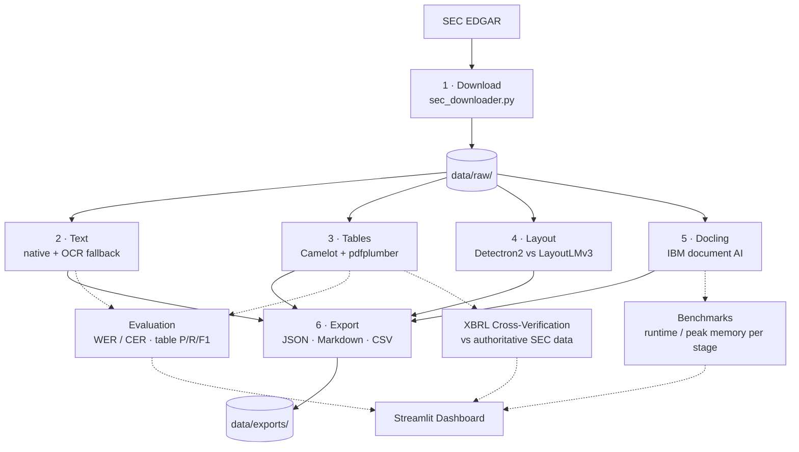

<div align="center">

# 📄 DocuParse

### Intelligent document parsing for SEC financial filings — with a verification layer most pipelines skip.

**Extract text, tables, and structure from 10-K / 10-Q filings → measure the extraction's own accuracy → cross-check every figure against the SEC's authoritative XBRL data.**

[](https://www.python.org/downloads/)
[](https://dvc.org/)
[](dashboard/app.py)
[](https://github.com/DS4SD/docling)
[](LICENSE)
[](.github/workflows/smoke-test.yml)

📊 **[Results Dashboard](dashboard/app.py)**

</div>

---

> ### 💡 The idea in one line
> **Extraction is the easy half. Knowing whether your extraction is *correct* is the hard half — and it's the half most document-AI projects skip.** A 10-K is hundreds of pages of dense financial tables, and a *silently* mis-parsed revenue figure is worse than no figure at all. DocuParse is built to catch exactly that.

---

## ✨ Highlights

- 🧩 **Six-stage, fully reproducible DVC pipeline** — download → text → tables → layout → Docling → export, each stage independently cached.
- 🔁 **Native-first text extraction with OCR fallback** — **99.56%** of pages handled natively; OCR runs only where it's truly needed.
- 📊 **Dual-model layout detection, measured not assumed** — Detectron2 *vs.* LayoutLMv3, run in parallel and compared head-to-head.
- 🤖 **IBM Docling integration** for integrated layout, table-structure, and reading-order understanding — all local, no data leaves the machine.
- ✅ **A real evaluation layer** — Word/Character Error Rate for text, precision/recall/F1 for tables, plus regression and distribution-drift monitoring.
- 🔍 **XBRL cross-verification** — validates extracted figures against the SEC's own machine-readable financial data: *free, authoritative ground truth.*
- 💰 **Build-vs-buy cost model** — priced against Google, AWS, and Azure with a derived **~50,000-page break-even** and a hybrid recommendation.
- 📈 **Interactive Streamlit dashboard** — explore evaluation metrics, benchmarks, cost analysis, and drift from the pipeline's recorded runs.
- 🩺 **Honest by design** — real failures are surfaced on the dashboard, not swallowed; small-ground-truth caveats are stated up front.

---

## 📑 Table of Contents

1. [Why This Project](#-why-this-project)
2. [The Problem](#-the-problem)
3. [Architecture & Data Flow](#-architecture--data-flow)
4. [The Six Pipeline Stages](#-the-six-pipeline-stages)
5. [Interactive Dashboard](#-interactive-dashboard)
6. [Quick Start](#-quick-start)
7. [Configuration](#-configuration)
8. [Repository Structure](#-repository-structure)
9. [Evaluation & Quality](#-evaluation--quality)
10. [Benchmarks](#-benchmarks)
11. [Build vs. Buy: Cost Analysis](#-build-vs-buy-cost-analysis)
12. [XBRL Cross-Verification](#-xbrl-cross-verification)
13. [Storage Format Decision](#-storage-format-decision)
14. [Distribution Drift Monitoring](#-distribution-drift-monitoring)
15. [Design Decisions & Tradeoffs](#-design-decisions--tradeoffs)
16. [Known Limitations](#-known-limitations)
17. [Technology Stack](#-technology-stack)
18. [Testing & CI](#-testing--ci)
19. [Reports Index](#-reports-index)
20. [License](#-license)

---

## 🎯 Why This Project

SEC filings are the authoritative source for public-company financials — analysts, investors, and regulators all depend on them. But they're published as **PDFs designed for humans, not machines**: hundreds of pages, multi-column layouts, tables spanning pages, footnotes, and numbers formatted in ways that break naive parsing.

DocuParse pairs a six-stage extraction pipeline with a full **evaluation layer**, a **benchmarking harness**, an **XBRL verification framework**, and an **interactive dashboard** — because getting data out of a filing is only valuable if you can trust it.

---

## 🧨 The Problem

| Challenge | Why it's hard |
|---|---|
| **Text vs. images** | Digital PDFs carry a text layer (fast, exact). Scanned pages are images needing OCR (slow, error-prone). You can't assume which you have. |
| **Financial tables** | Borderless tables, tables spanning pages, and columns that are really just aligned text all defeat single-tool extraction. |
| **No ground truth** | Normally, verifying extraction means a human labelling every number — which doesn't scale. |
| **A wrong number is worse than no number** | Silent mis-parsing corrupts downstream analysis with no warning. Verification has to be first-class. |

---

## 🏗️ Architecture & Data Flow

A **six-stage DVC DAG**. Stages 2–5 are independent — they all read the same raw PDFs and write to separate directories, so a failure in one extractor never blocks the others, and DVC re-runs only the stages whose inputs or parameters changed. Only export fans everything back in.



```
SEC EDGAR
   │
   ▼
┌─────────────┐
│ 1. DOWNLOAD │  params: companies, fiscal_years, filing_types
└─────────────┘  → data/raw/
   │
   ├────────────────┬────────────────┬────────────────┐
   ▼                ▼                ▼                ▼
┌──────────┐  ┌──────────┐  ┌──────────────┐  ┌──────────┐
│ 2. TEXT  │  │3. TABLES │  │ 4. LAYOUT    │  │5. DOCLING│
│ native + │  │ Camelot +│  │ Detectron2 + │  │ IBM doc  │
│ OCR f/b  │  │pdfplumber│  │ LayoutLMv3   │  │ AI       │
└──────────┘  └──────────┘  └──────────────┘  └──────────┘
   │                │                │                │
   └────────────────┴───────┬────────┴────────────────┘
                            ▼
                    ┌───────────────┐
                    │  6. EXPORT    │  JSON · Markdown · CSV
                    └───────────────┘
                            │
        ┌───────────────────┼───────────────────┐
        ▼                   ▼                   ▼
   EVALUATION          BENCHMARKS         XBRL VALIDATION
   WER / CER           runtime/memory     cross-check vs
   table P/R/F1        per stage          SEC authoritative
        └───────────────────┴───────────────────┘
                            ▼
                   📊 Streamlit Dashboard
```

---

## ⚙️ The Six Pipeline Stages

### 1 · Download
Pulls filings from **SEC EDGAR**, parameterised by company, fiscal year, and filing type in `params.yaml`. Making download a pipeline stage (rather than a manual step) buys reproducibility: anyone can `dvc repro` and rebuild the same corpus. The included corpus is Meta's filings (CIK `0001326801`), 2024 10-K and 10-Q.

### 2 · Text Extraction — native with OCR fallback ⭐
The most important design decision in the pipeline. A PDF may or may not have a **text layer**. The extractor **tries native parsing first and falls back to OCR (Tesseract) only when a page yields no usable text**. Result: **99.56% of pages handled natively** — OCR ran on roughly half a percent.

> **Why it matters:** OCR is orders of magnitude slower and less accurate than reading a native text layer. OCR-everything pays that cost on every page for no benefit on the 99% that don't need it. The fallback only pays where it has to — which is why the text stage runs in milliseconds.

### 3 · Table Extraction — Camelot + pdfplumber
Financial tables are the hardest and most valuable part of a filing. Two libraries with complementary strengths run together:
- **Camelot** — strong on ruled tables (lattice) and whitespace-delimited tables (stream)
- **pdfplumber** — general-purpose inspection, good at word positions and simpler tables

No single extractor handles every layout, so running both and taking the better result covers more cases than betting on one.

### 4 · Layout Detection — Detectron2 vs. LayoutLMv3, in parallel
Layout detection identifies **regions** on a page — title, paragraph, table, figure — as computer vision on the rendered page image.

| Model | What it is | Strength |
|---|---|---|
| **Detectron2** | Facebook's object-detection framework, applied to document regions | Pure visual detection — finds and boxes regions |
| **LayoutLMv3** | Microsoft's **multimodal** model (text + layout + image) | Understands semantics, not just geometry; better at captions |

Both run on the same pages and write to `detectron2/`, `layoutlmv3/`, and a `comparison/` directory — the point isn't to pick one blindly but to **measure them against each other** on processing time, blocks detected, and caption extraction.

### 5 · Docling — IBM's document AI
**Docling** does layout analysis, table-structure recognition, and reading-order detection in one integrated pipeline, running locally. It's also the pipeline's **bottleneck by a wide margin** — a measurement the project surfaces rather than hides (see [Benchmarks](#-benchmarks)).

### 6 · Export
Fans in from all four extraction stages plus metadata and writes **JSON, Markdown, and CSV**, with an optional pipeline summary report (see [Storage Format Decision](#-storage-format-decision)).

---

## 📊 Interactive Dashboard

A **Streamlit** results dashboard ([`dashboard/app.py`](dashboard/app.py)) makes the pipeline's recorded outputs explorable. It reads the committed JSON/markdown the pipeline already produced — it does **not** run the heavy extraction live — so it's fast, cheap, and deployable on a free tier.

```bash
pip install -r dashboard/requirements.txt
streamlit run dashboard/app.py
```

**Six views:**

| View | What it shows |
|---|---|
| 🧠 **About & Skills** | Project summary and the key concepts it demonstrates |
| 📋 **Overview** | Headline evaluation metrics (WER/CER, table P/R/F1) with pass/fail vs. thresholds, and metric history over time |
| ⏱️ **Benchmarks** | Per-stage runtime and peak memory, plus any recorded failures — surfaced, not hidden |
| 💰 **Cost (Build vs Buy)** | Cloud service pricing vs. self-hosted infrastructure, with the break-even point |
| 📈 **Distribution Drift** | Histograms of words/sentences per chunk and numeric-token ratio across pages |
| 📄 **Reports** | Renders the written analysis reports in-app |

> 🧪 **Engineering detail worth noting:** all data access lives in [`dashboard/data_loader.py`](dashboard/data_loader.py), which depends only on the Python standard library — so it's **unit-tested without Streamlit, pandas, or the heavy ML stack**. And a dedicated lightweight [`dashboard/requirements.txt`](dashboard/requirements.txt) sits next to the entrypoint: Streamlit Community Cloud searches the entrypoint's directory first, so this keeps torch and Docling out of the hosted build entirely — making a free-tier deploy viable for a project with a heavy dependency tree.

Every page shows a **"static snapshot"** provenance banner so viewers know the figures come from a recorded run, not a live one. A live "upload a PDF and parse it" demo is intentionally out of scope — the extraction stack (Docling, layout models, OCR) is heavy and slow to host.

---

## 🚀 Quick Start

### Prerequisites
- **Python 3.9+**
- [DVC](https://dvc.org/) for pipeline orchestration
- System dependencies for OCR and rendering: **Tesseract** and **Poppler** (for `pdf2image`)

### Run the pipeline

```bash
# 1. Clone and install
git clone https://github.com/DhanvardiniRajendran25/Docuparse.git
cd Docuparse
python3 -m venv venv
source venv/bin/activate          # Windows: venv\Scripts\activate
pip install -r requirements.txt

# 2. Run the full pipeline (DVC runs only what's stale)
dvc repro

# 3. Inspect outputs
ls data/exports/

# 4. Run a single stage, or force a rerun
dvc repro extract_text
dvc repro --force extract_docling
```

### Launch the dashboard

```bash
pip install -r dashboard/requirements.txt
streamlit run dashboard/app.py
```

> **Tip:** because stages are cached by inputs and parameters, editing `docling.max_pages` in `params.yaml` re-runs only Docling and export — nothing else.

---

## 🔧 Configuration

All behaviour is controlled from [`params.yaml`](params.yaml):

```yaml
download:
  companies: ["META"]
  fiscal_years: [2024]
  filing_types: ["10-K", "10-Q"]

text_extraction:
  use_ocr_fallback: true          # native first, OCR only on failure
  ocr_confidence_threshold: 60

table_extraction:
  flavor: "lattice"               # or "stream"
  edge_tol: 50

layout_detection:
  pages_to_process: "all"
  detectron2_confidence_threshold: 0.5
  dpi: 200

docling:
  max_pages: null                 # null = all pages
  output_formats: ["json", "markdown"]

export:
  formats: ["json", "markdown", "csv"]
  include_summary: true
```

---

## 🗂️ Repository Structure

```
Docuparse/
├── dashboard/                            # 📊 Streamlit results dashboard
│   ├── app.py                            #   six-view UI (reads recorded outputs)
│   ├── data_loader.py                    #   pure-stdlib, unit-tested data access
│   └── requirements.txt                  #   lightweight deps (keeps torch out of deploy)
├── src/
│   ├── downloaders/
│   │   └── sec_downloader.py             # SEC EDGAR download
│   ├── extractors/
│   │   ├── text_extractor.py             # native + OCR fallback
│   │   ├── table_extractor.py            # Camelot + pdfplumber hybrid
│   │   ├── layout_detector.py            # Detectron2 vs LayoutLMv3
│   │   └── docling_parser.py             # IBM Docling
│   ├── parsers/
│   │   ├── docling_or_fallback_parser.py # Docling → Google Doc AI fallback
│   │   ├── docai_parser.py               # Google Document AI parser
│   │   ├── docling_one_page.py
│   │   └── metadata_schema.py
│   ├── representations/
│   │   ├── metadata_builder.py
│   │   └── metadata_storage_formats.py   # JSON / Markdown / TXT comparison
│   ├── exporters/
│   │   └── final_exporter.py             # fans in all stages
│   ├── validation/
│   │   └── xbrl_cross_verification.py    # SEC XBRL cross-check
│   └── benchmarking/
│       ├── corrected_real_benchmarker.py # per-stage runtime/memory
│       └── cloud_cost_estimator.py       # build-vs-buy cost model
├── evaluation/
│   ├── run_evaluation.py
│   ├── metrics/                          # text_accuracy, table_accuracy, DVC metrics
│   ├── ground_truth/                     # hand-labelled reference items
│   ├── visualizations/distribution_drift.py
│   └── tests/
├── reports/                              # written analyses (see index below)
├── benchmarks/results/                   # benchmark + cost-analysis JSON
├── tests/
│   ├── unit/test_dashboard_data.py       # fast, dependency-light suite
│   ├── integration/test_text_extraction.py
│   └── smoke.sh
├── notebooks/                            # demos & development
├── .github/workflows/smoke-test.yml      # CI
├── dvc.yaml                              # pipeline DAG
├── params.yaml                           # all parameters
├── requirements.txt                      # pipeline deps
├── requirements-dev.txt                  # fast-test deps
├── pytest.ini
├── CONTRIBUTING.md
└── LICENSE
```

---

## ✅ Evaluation & Quality

The evaluation harness ([`evaluation/run_evaluation.py`](evaluation/run_evaluation.py)) scores extraction against a hand-built ground-truth set.

| Metric | Value | Meaning |
|---|---|---|
| **Text WER** | **0.0260** | Word Error Rate — 2.6% of words differ from reference |
| **Text CER** | **0.0039** | Character Error Rate — 0.39% |
| **Table precision** | **1.0000** | Of cells extracted, fraction correct |
| **Table recall** | **1.0000** | Of cells that should be extracted, fraction found |
| **Table F1** | **1.0000** | Harmonic mean of precision and recall |
| **Overall pass rate** | **1.000** | All evaluated items passed their thresholds |

> ⚠️ **Stated honestly:** these numbers were computed on **4 hand-labelled ground-truth items** (2 text pages, 2 tables). Treat them as **directional, not production-grade accuracy claims**. The real deliverable is the *infrastructure to measure* extraction quality and catch regressions; **scaling the ground-truth set is the obvious next step** (the dashboard says as much on its Overview page).

---

## ⏱️ Benchmarks

Per-stage runtime and peak memory, from a deliberately **capped profiling run** ([`benchmarks/results/`](benchmarks/results/)). Platform: macOS, 8 CPU cores, 8 GB RAM, Python 3.9.10, max 10 pages/stage.

| Stage | Runtime (s) | Pages | Peak memory (MB) | Per page (s) |
|---|---|---|---|---|
| text_extraction | 0.01 | — | 70.2 | 0.01 |
| table_extraction | 9.92 | 5 | 188.8 | 1.98 |
| **docling** | **169.01** | 5 | **562.3** | **33.80** |

**Docling is the bottleneck — ~17× slower per page than table extraction.** If you were to optimise one stage, it's the only one worth touching. The instinct this encodes: **measure first, then optimise the thing that's actually slow.**

🩺 **Failures surfaced, not hidden.** The same benchmark records a real file-level failure — `text_extraction` on `2024_meta_10-q.pdf` (`too many values to unpack (expected 2)`) — timestamped and shown on the dashboard. *A pipeline that silently drops documents is more dangerous than one that fails loudly.*

### Full-corpus throughput
Separately from the capped benchmark, a full-corpus extraction run processed **~676 pages in ~3 minutes**, with **99.56% native text extraction**, **187 tables** extracted, and **2,954 XBRL concepts** parsed for verification. *(Different runs: the 676-page figure is the full corpus for text/table extraction; the per-stage benchmark above is a capped run used purely for profiling.)*

---

## 💰 Build vs. Buy: Cost Analysis

The cost model ([`src/benchmarking/cloud_cost_estimator.py`](src/benchmarking/cloud_cost_estimator.py)) prices self-hosting against the major cloud document-AI services, per 1,000 pages:

| Option | Cost per 1,000 pages |
|---|---|
| Google Document AI — OCR | ~$1.50 |
| Google Document AI — Form Parser | ~$50 |
| AWS Textract (detect → analyze) | $1.50 – $50 |
| Azure Form Recognizer | $10 – $50 |
| **Self-hosted (this pipeline)** | **~$0.03 – $1.05** |

**📍 Break-even: ~50,000 pages.** Below that volume, buying is cheaper once setup is accounted for; above it, self-hosting wins.

> **The recommendation isn't "open source wins" — it's a hybrid.** Use Docling as the default (free, local), and fall back to a cloud parser for low-quality scans or table-heavy pages where Docling is weak. That fallback is implemented: [`src/parsers/docling_or_fallback_parser.py`](src/parsers/docling_or_fallback_parser.py) tries Docling first and automatically falls back to Google Document AI if it fails or returns no pages.

**Two caveats stated up front:** the cost figures **exclude engineering and maintenance time** (the real hidden cost of self-hosting), and **privacy matters** — Docling runs locally with no data transfer, while cloud options require uploading financial documents, which can be the deciding factor in a regulated setting regardless of price.

---

## 🔍 XBRL Cross-Verification

The hardest problem in document extraction is that there's usually **no ground truth**. DocuParse exploits a shortcut specific to SEC filings: companies submit **XBRL** (eXtensible Business Reporting Language) — the same financial data in structured, machine-readable form — *alongside* the human-readable PDF. That's free, authoritative data to cross-check against.

[`src/validation/xbrl_cross_verification.py`](src/validation/xbrl_cross_verification.py) integrates the SEC Company Facts API, parses the US-GAAP and DEI taxonomies, and loads the extracted tables for comparison:

- **2,954 XBRL financial data points** parsed for META (2023–2024)
- **187 PDF tables** loaded for cross-checking
- Verified matches after unit conversion — e.g. XBRL `us-gaap:Revenues = $134,902,000,000` ↔ PDF `Revenue = 134,902 (millions)` ✅

> **Status, stated plainly:** the download, parsing, and comparison *framework* is complete, and manual verification confirms matching values. **Fully automated matching is the active next step** — XBRL stores exact values while PDFs show figures in millions, and concept labels (`us-gaap:Revenues` vs. "Total Revenue") need fuzzy mapping. The foundation — authoritative data on one side, extracted data on the other — is in place. See [`reports/xbrl_cross_verification_report.md`](reports/xbrl_cross_verification_report.md).

---

## 🗃️ Storage Format Decision

The export stage emits three formats; the primary choice is documented in [`reports/storage_formats_analysis.md`](reports/storage_formats_analysis.md):

| Format | Pro | Con |
|---|---|---|
| JSON | Structured, machine-readable, good for automation | Verbose — repeated keys make it ~2× Markdown's size |
| **Markdown** (primary) | Preserves headings, lists, tables; human-readable; **feeds naturally into LLM/RAG pipelines** | Less standardised for programmatic parsing |
| TXT | Tiny, universal | Strips all structure — kills downstream utility |

**Decision:** Markdown primary, JSON secondary for programmatic needs, TXT as a baseline only. Markdown is the middle ground — smaller than JSON, but unlike TXT it retains the semantic structure, and it's the format downstream retrieval pipelines actually want.

---

## 📈 Distribution Drift Monitoring

[`evaluation/visualizations/distribution_drift.py`](evaluation/visualizations/distribution_drift.py) tracks the **shape** of extracted output across runs — words per chunk, sentences per chunk, and numeric-token ratio (a proxy for "table vs. prose"). If those distributions shift between runs, something changed: a new document format, a model update, or a regression. This catches **silent degradation** that a pass/fail test would miss, because a pipeline can "succeed" while quietly producing worse output. These distributions are visualised live on the dashboard's **Distribution Drift** page.

---

## 🧭 Design Decisions & Tradeoffs

| Decision | Chosen | Over | Why | Cost accepted |
|---|---|---|---|---|
| Text extraction | Native-first, OCR fallback | OCR everything | 99.56% of pages have a usable text layer; OCR is far slower | More branching; need a reliable "needs OCR" signal |
| Table extraction | Camelot + pdfplumber hybrid | A single library | No one extractor handles every table layout | Two tools to run and reconcile |
| Layout detection | Two models, compared | Picking one upfront | No basis to choose without measuring | Double the layout compute + a comparison harness |
| Orchestration | DVC pipeline | A plain script | Stage-level caching and reproducibility over expensive stages | DVC setup and DAG maintenance |
| Build vs. buy | Hybrid (local default + cloud fallback) | All-local or all-cloud | Balances cost, quality, and privacy | Two code paths to maintain |
| Output format | Markdown primary | JSON-only | Smaller than JSON, structured (unlike TXT), RAG-friendly | Less standard for machine parsing (JSON kept as secondary) |
| Dashboard | Reads committed outputs | Live pipeline demo | Extraction stack is heavy/slow to host; keeps the deploy lightweight | No interactive "upload a PDF" demo |
| Verification | XBRL cross-check | Manual labelling only | Free authoritative ground truth from the SEC | Unit/concept mapping still being automated |

---

## ⚠️ Known Limitations

- **Tiny ground-truth set (4 items).** The evaluation infrastructure is the deliverable; the ground truth needs scaling before any metric is a production accuracy claim.
- **Docling is slow (~33.8 s/page).** The measured bottleneck. Mitigations: parallelise across pages, run Docling selectively on table-heavy pages, or use the cloud fallback above the volume threshold.
- **XBRL matching is semi-automated.** Download/parse/compare framework is complete; unit conversion and fuzzy concept mapping are next.
- **Single-company corpus.** Filings under one CIK (Meta). Layout varies by preparer, so generalising across filers is the obvious next test.
- **Batch pipeline, not a live service.** Turning it into an API would mean queuing, async workers for the slow stages, and caching by document hash.
- **Cost analysis excludes engineering time.** The self-hosting figures are infrastructure-only.

---

## 🧰 Technology Stack

| Area | Technology |
|---|---|
| Pipeline / reproducibility | DVC |
| Text + OCR | pdfplumber, PyMuPDF, Tesseract (`pytesseract`), EasyOCR |
| Tables | Camelot, pdfplumber, tabula-py |
| Layout | Detectron2, LayoutLMv3 (`transformers`), LayoutParser, pdf2image |
| Document AI | Docling (IBM), Google Document AI (fallback) |
| Verification | SEC EDGAR / Company Facts API, XBRL (US-GAAP, DEI) |
| ML / CV runtime | PyTorch, torchvision, OpenCV, scikit-image, scikit-learn |
| Data / analysis | pandas, NumPy, Matplotlib, seaborn |
| Dashboard | Streamlit, Plotly |
| Testing / CI | pytest, GitHub Actions |

---

## 🧪 Testing & CI

```bash
# Fast, dependency-light unit suite (dashboard data loader) — no heavy stack needed
pip install -r requirements-dev.txt
pytest                         # configured via pytest.ini → tests/unit

# Integration test (text extraction) — needs the extraction stack
pytest tests/integration/test_text_extraction.py -v

# Smoke test
bash tests/smoke.sh
```

The fast unit suite ([`tests/unit/test_dashboard_data.py`](tests/unit/test_dashboard_data.py)) validates the dashboard's data transforms against both synthetic fixtures and the real committed outputs — without importing Streamlit, pandas, or the ML stack, so it runs quickly and deterministically. CI runs the smoke test on every pull request against `main` and `develop` via [`.github/workflows/smoke-test.yml`](.github/workflows/smoke-test.yml).

---

## 📚 Reports Index

In-depth written analyses live in [`reports/`](reports/) (and render inside the dashboard's **Reports** page):

| Report | Covers |
|---|---|
| `benchmarks.md` | Per-stage runtime, memory, and bottleneck analysis |
| `text_analysis.md` | Text extraction deep dive and native/OCR split |
| `docling_vs_custom_comparison.md` | Docling vs. the custom extractors |
| `layout_detection_analysis.md` | Detectron2 vs. LayoutLMv3 comparison |
| `storage_formats_analysis.md` / `metadata_storage_formats_Evaluated.md` | JSON vs. Markdown vs. TXT |
| `side_by_side_comparison.md` | Output comparison across methods |
| `xbrl_cross_verification_report.md` | XBRL validation implementation and findings |

---

## 📄 License

This project is licensed under the MIT License — see the [LICENSE](LICENSE) file for details. Contributions are welcome; see [CONTRIBUTING.md](CONTRIBUTING.md).
